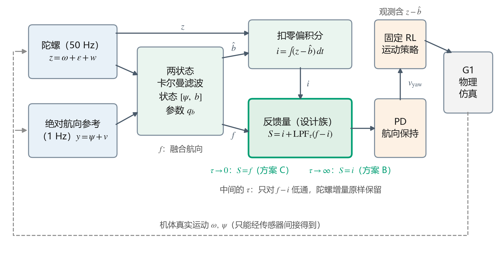
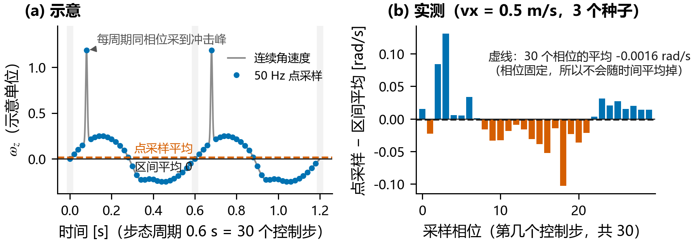

# Unitree G1 固定 RL 策略下的航向保持反馈研究

> 📄 **完整技术报告**：[**点此阅读《固定 RL 运动策略下人形机器人航向保持的反馈方案研究》（heading_feedback_report.md）**](heading_feedback_report.md)  
> 🔧 **基础仿真框架文档**：[上游 `unitree_rl_mjlab` 使用说明](doc/README_upstream.md)

---

##  实验目的

训练好的足式机器人强化学习（RL）运动策略通常只负责响应局部速度指令 $(v_x, v_y, v_{\mathrm{yaw}})$，**自身不具备保持全局航向的能力**——哪怕给定 $v_{\mathrm{yaw}}=0$，步态不对称与微小扰动也会让机器人越走越偏。

为了在不重新训练底层策略的前提下让 **Unitree G1** 稳定走直线，需要在冻结的 PPO 策略之上加一层航向 PD 控制，并用卡尔曼滤波融合 **50 Hz 陀螺仪**（快、连续、但有零偏漂移）与 **1 Hz 低频绝对航向参考**（不漂移、但带噪且可能中断）。

在工程落地时，有三个直接影响表现却常被拍脑袋决定的问题：
1. **反馈怎么接？** 滤波器的输出可以**扣除估计零偏后独立积分（方案 B，平滑无跳变）**，也可以**直接使用融合航向（方案 C，每次参考更新产生跳变）**。各自最优整定下谁更准？能不能既要 C 的精度、又要 B 的平滑？
2. **陀螺信号准吗？** 行走时机体周期性摇摆、落脚冲击剧烈，直接按 50 Hz 控制周期读取角速度 $\omega_z$ 积分，会不会引入除器件零偏之外的系统误差？
3. **参考断了怎么办？** 视觉/激光/GNSS 参考暂时丢失又恢复时，不同接法怎么漂移、怎么跳变？底层 RL 策略会被恢复瞬间的转向指令跳变晃倒吗？

本项目把两种反馈接法统一为双参数设计族 $S(q_b, \tau)$，通过**精确的线性误差分解**与 **243 条闭环仿真实验**给出了定量解答。



---

##  三个核心发现

### 1. 直接融合（C）远优于扣零偏积分（B），加 $\tau \approx 1\text{ s}$ 修正量低通（`S1`）可兼得精度与平滑
我们将两种接法统一为 $S_k = i_k + \mathrm{LPF}_\tau(f_k - i_k)$（类比对 ROS 中 `map -> odom` 的修正偏移做一阶低通）：
- **为什么淘汰 B？** 方案 B（$\tau\to\infty$）从不直接修正航向，开机早期零偏收敛前的误差被**永久积分**进航向，误差不随时间下降；方案 C（$\tau\to 0$）的误差下限仅由参考决定（约 $\sqrt{3}\sigma_a/\sqrt{N}$，随时间按 $1/\sqrt{t}$ 衰减）。在各自最优整定下，`C*` 的名义误差（**0.80°**）仅为 `B*`（**2.39°**）的 1/3。
- **平滑折中 `S1`**：在 `C*` 上取 **$\tau = 1\text{ s}$**（方案 `S1`），高频陀螺增量无延迟通过，仅平滑低频参考修正。**精度损失 < 0.04°**，却能把收敛期的最大单步反馈跳变从 **1.77° 压到 0.40°**（转向指令跳变降低 6 倍，达到步态自身底噪）。$\tau$ 的精度上限（MEMS 陀螺为 2～3 s）仅由陀螺质量决定，与参考频率无关。

### 2. 50 Hz 点采样与步态周期锁相会产生“假零偏”，所谓“变速需要调大 $q_b$”是混叠假象
实验发现：即使陀螺仪**零偏为 0、噪声为 0**，直接用 50 Hz 点采样的 $\omega_z$ 积分 55 s，航向也会跑偏最高 **10.9°**，且漂移方向随步速变号。
- **根源**：G1 的步态周期约 0.6 s，**恰好等于 30 个控制步（$30 \times 0.02\text{ s}$）**。采样时刻与步态相位严格锁相，落脚冲击的窄尖峰无法在时间上平均掉，形成与真实零偏不可区分的“步态等效零偏”（量级 $10^{-3}\text{ rad/s}$）。
- **变速假象与解决**：当机器人变速时，步态混叠项发生阶跃，看起来像“陀螺零偏突然变了”，误导工程师调大过程噪声 $q_b$。改用**区间平均角速度（角增量）并按欧拉率公式解算 $\dot{\psi}$** 后，全步速（0.2～1.0 m/s）下 55 s 纯积分误差均降至 **< 0.3°**，变速时无需调大 $q_b$。



### 3. 参考中断时 B 彻底失控，`S1` 实现无扰恢复，且冻结的 RL 策略对日常指令跳变相当鲁棒
在 90 s 运行的第 [20, 50) s 切断绝对参考（中断 30 s）：
- **`B*` 发散**：`B*` 为压低早期偏置被迫采用大 $q_b$，导致零偏估计跟着参考噪声跳动；中断瞬间冻结了带噪零偏，以约 2°/s 持续跑偏，恢复参考后误差仍停在 **49.4°** 无法拉回；而 `C*` 仅漂移约 1°，恢复后回到 **0.61°**。
- **`S1` 无扰恢复**：`C*` 在恢复首拍因协方差膨胀产生 **1.91°** 跳变，`S1`（$\tau=1\text{ s}$）将其无延迟平滑至 **0.39°**。
- **策略承受度**：向底层 RL 策略注入持续 1 s 的转向指令矩形脉冲，在 `C*` 实际跳变量级（0.05～0.125 rad/s）下，机身最大倾角超额增量仅 **0.007°～0.077°**（直至 2.0 rad/s 均未摔倒）。说明平滑的核心价值在于消除指令毛刺、改善航向瞬态，而非防摔。

| 方案（点采样） | 名义误差 [30, 60) s | 名义反馈跳变 | 30 s 中断恢复后误差 [60, 90) s | 中断恢复瞬间跳变 |
|---|---:|---:|---:|---:|
| **`B*`**（扣零偏独立积分，$q_b=10^{-4}, \tau=\infty$） | 2.39° | 0.42° | 49.4°（发散不恢复） | 0.39° |
| **`C*`**（直接融合反馈，$q_b=10^{-16}, \tau=0$） | **0.80°** | 1.77° | **0.61°** | 1.91° |
| **`S1`**（修正量低通，$q_b=10^{-16}, \tau=1\text{ s}$） | **0.81°** | **0.40°** | **0.63°** | **0.39°** |

---

## 🛠️ 四条工程落地准则

1. **反馈结构选 `S1`，弃用纯积分方案 B**：用 $S_k = i_k + \mathrm{LPF}_\tau(f_k - i_k)$ 接入控制器，MEMS 陀螺取 **$\tau \approx 1\text{ s}$**，同时拿到 `C*` 的精度/抗中断能力与 `B*` 的平滑度。
2. **用帧间角增量 + 欧拉率换算代替控制步点采样**：避免 50 Hz 控制采样与步态周期整数倍锁相混叠，从源头消除随步速变号的“假零偏”。
3. **不要为了适应变速去调大 $q_b$**：中短时程将 $q_b$ 设为极小值以充分利用历史参考抑噪；长时程仅按器件手册的真实温漂（Bias Instability）设定 $q_b$。
4. **外环控制器加微弱积分项（PID）**：在 `S1` 提供无偏航向反馈的基础上，用小积分项消除冻结 RL 策略直行不对称性带来的约 $1^\circ$ 物理静差。

---

## 🚀 快速复现

仓库内已包含预计算的统计汇总表与全套分析脚本；全部 243 条闭环仿真原始轨迹（`.npz`）已打包发布在 [**GitHub Releases (`v1.0`)**](https://github.com/ThorHe-Hub/unitree_rl_mjlab/releases/tag/v1.0) 中。解压后无需重跑 GPU 仿真即可在数秒内复现所有统计表、离线网格与图表：

```bash
# 0. 下载并解压闭环实验原始轨迹数据包（约 225 MB）
curl -L https://github.com/ThorHe-Hub/unitree_rl_mjlab/releases/download/v1.0/heading_experiment_data.tar.gz | tar -xz

# 1. 复现设计族闭环实验（208 条）与指令脉冲实验（35 条）统计结果
python analyze_design_family_formal.py
python analyze_pulse_formal.py

# 2. 运行离线参数网格扫描、协方差递推与反事实重放分析
python analyze_design_family.py
python analyze_design_family_sweeps.py
python analyze_thesis_supplement.py

# 3. 重新生成全部图表（输出至 figs/v3/）
python make_figures_v3.py

# 4. 运行单元测试
python -m unittest discover -s tests
```
