# 固定 RL 运动策略下人形机器人航向保持的反馈方案研究

> **项目背景**：在部署训练好的足式机器人强化学习（RL）步态策略时，底层策略通常只负责跟踪线速度与转向角速度指令 $(v_x, v_y, v_{\mathrm{yaw}})$，并不具备全局航向保持能力。要让机器人走出直线，需要在冻结的 RL 策略之上加一层航向控制闭环。
>
> 本文基于 **Unitree G1**（MuJoCo / mjlab 仿真），在不重训底层 PPO 策略的前提下，研究上层航向反馈的接入方式、陀螺采样与步态锁相造成的隐蔽系统误差、以及参考信号中断与恢复时的平滑切换问题。

---

## 核心结论速览（TL;DR）

1. **直接融合（C）远优于扣零偏独立积分（B），且可通过修正量低通 $S(q_b, \tau)$ 兼顾精度与平滑**
   - 同一个两状态卡尔曼滤波器（估计航向 $f$ 与陀螺零偏 $\hat{b}$）接上层控制器时，如果只用 $\hat{b}$ 补偿陀螺后独立积分（方案 B），早期未收敛的零偏误差会被永久积分进航向，误差不随运行时间下降；直接使用融合航向（方案 C）时，误差下限仅由参考噪声决定（约 $\sqrt{3}\sigma_a/\sqrt{N}$，随时间按 $1/\sqrt{t}$ 衰减）。
   - 在各自最优整定下，名义工况中 `C*` 的航向估计误差（0.80°）仅为 `B*`（2.39°）的三分之一。
   - 把两种方案统一为 $S = i + \mathrm{LPF}_\tau(f - i)$（等价于对 ROS 中 `map -> odom` 的修正偏移做一阶低通）：取 **$\tau \approx 1\text{ s}$**（方案 `S1`）几乎不损失任何精度（差距 < 0.04°），就能把参考更新带来的反馈跳变从 1.8° 压到 0.4°（步态自身的摆动水平）。$\tau$ 的可用上限由陀螺质量决定（MEMS 档为 2～3 s），与参考更新频率无关。

2. **50 Hz 点采样与步态周期锁相会产生“假零偏”，所谓“变速需要调大 $q_b$”是混叠假象**
   - G1 的步态周期约 0.6 s，恰好是 50 Hz 控制频率下的 30 个控制步。点采样时刻与步态相位严格锁相，落脚冲击的窄尖峰无法在时间上平均掉，再加上横滚–俯仰耦合的欧拉角非线性项，导致单轴陀螺积分出现随步速变号的系统漂移（55 s 纯积分误差最高达 **10.9°**）。
   - 滤波器无法区分这一步态误差与真实零偏。当机器人变速时，步态混叠项发生阶跃，看起来像是“陀螺零偏突然变了”，从而让人误以为需要调大零偏过程噪声 $q_b$。改用**区间平均角速度（角增量）并按欧拉率公式解算**后，全步速下 55 s 积分误差均小于 **0.3°**，变速时无需调大 $q_b$，极小 $q_b$ 的 `C*` 依然全局最优。

3. **参考信号中断时 B 彻底发散，S1 实现无扰恢复，且冻结的 RL 策略对日常指令跳变相当鲁棒**
   - `B*` 为了在名义工况下尽快收敛，被迫采用较大的 $q_b$，导致零偏估计跟着参考噪声跳动。一旦绝对参考中断 30 s，`B*` 冻结了一个带噪的零偏，以约 2°/s 的速度持续跑偏，恢复参考后误差也停留在 **49°** 无法拉回；而 `C*` 在中断期间仅漂移约 1°，恢复后回到 **0.6°**。
   - `C*` 的代价是参考恢复瞬间因协方差膨胀产生一次约 1.9° 的反馈跳变，`S1`（$\tau=1\text{ s}$）可将其无延迟地平滑至 **0.4°**。
   - 进一步的指令脉冲实验表明，底层 RL 策略对收敛期或恢复期实际量级的转向指令跳变（0.05～0.125 rad/s）并不敏感，机身最大倾角增量不足 0.08°；平滑的主要工程价值在于保证指令通道平顺与航向瞬态平滑，而非防止摔倒。

---

## 1. 系统架构与统一反馈族 $S(q_b, \tau)$

### 1.1 控制闭环与传感器设定

实验平台为 Unitree G1 平地直行任务（前进指令 $v_x = 0.5\text{ m/s}, v_y = 0$），物理步长 0.005 s，控制周期 $\Delta t = 0.02\text{ s}$（50 Hz）。底层为训练好并冻结权重的 PPO 速度跟踪策略；上层航向控制器根据航向反馈量 $S$ 计算转向角速度指令：

$$v_{\mathrm{yaw},k} = \operatorname{clip}_{[-1.6,\,1.6]}\left(-K_p S_{k-1} - K_d\,\frac{S_{k-1}-S_{k-2}}{\Delta t}\right), \qquad K_p=0.91,\ K_d=0.01$$

> **注：为什么上层只用 PD 而不加积分项（I）？**
> G1 的冻结策略在直行时存在轻微的不对称性，需要平均约 $0.017\text{ rad/s}$ 的转向指令才能保持直走。使用纯 PD 时，这会表现为反馈量 $S$ 上约 $-0.017/K_p \approx -1^\circ$ 的共同稳态偏置。我们在实验中故意不加积分项，是为了**防止控制器的积分器与状态估计器的零偏积分器发生动态耦合**，从而干净地分离出估计误差 $\varepsilon = S - \psi$。实际工程部署时，外环加上积分项即可消除这 $-1^\circ$ 的物理偏置。

航向估计融合两类传感器：
- **陀螺仪（主档取 Bosch BMI088 规格）**：50 Hz 连续采样，每步噪声标准差 $\sigma_g = 1.728\times 10^{-3}\text{ rad/s}$，常值开机零偏 $b_0 = 0.02\text{ rad/s}$（约 $1.15^\circ/\text{s}$）。另设一个噪声放大 87 倍的“压力档”（$\sigma_g = 0.15\text{ rad/s}$）用于测试极端劣化边界。
- **低频绝对航向参考**：模拟磁力计、激光/视觉定位或双天线 GNSS，默认更新率 $f_{\mathrm{ref}} = 1\text{ Hz}$，带一拍延迟，量测噪声标准差 $\sigma_a = 0.05\text{ rad}$（约 $2.86^\circ$）。

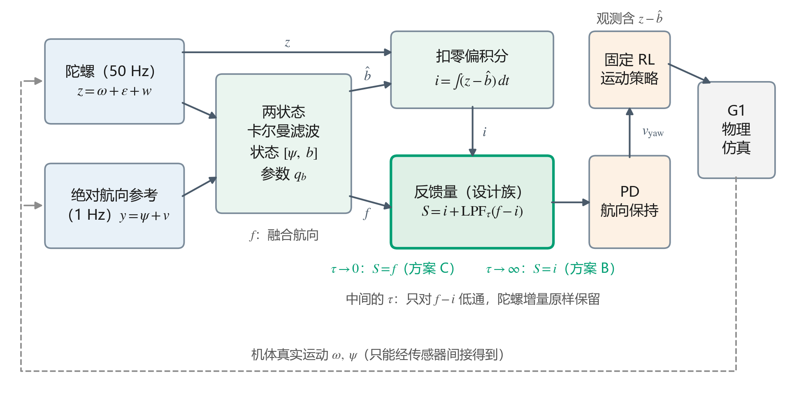

### 1.2 两状态卡尔曼滤波与反馈接法

用标准的两状态卡尔曼滤波器估计航向 $f$ 与陀螺零偏 $\hat{b}$，状态向量 $X = [f, \hat{b}]^\mathsf{T}$，把陀螺读数 $z_k$ 作为系统输入：
- **预测步（50 Hz）**：
  $$X^-_k = \begin{bmatrix}1 & -\Delta t \\ 0 & 1\end{bmatrix} X_{k-1} + \begin{bmatrix}\Delta t \\ 0\end{bmatrix} z_k, \qquad P^-_k = F P_{k-1} F^\mathsf{T} + \begin{bmatrix}(\sigma_g\Delta t)^2 & 0 \\ 0 & q_b\end{bmatrix}$$
- **更新步（参考到达时，默认 1 Hz）**：用参考量测 $y_k = \psi_{k-1} + \eta_k$ 更新状态与协方差（Joseph 形式）。初始先验取 $P_0 = \operatorname{diag}(0.01^2, 0.05^2)$，对应初始方向已知、开机零偏未知。

这里 $q_b$ 是零偏过程噪声方差，实质上是决定滤波器“相信历史参考平均值”还是“紧跟最新参考”的整定参数。

拿到滤波器输出后，工程上给控制器喂反馈量 $S$ 有两种常见接法：
- **方案 B（扣零偏独立积分）**：$i_k = i_{k-1} + (z_k - \hat{b}_k)\Delta t$，令 $S = i$。航向本身不被参考直接重置，只通过 $\hat{b}$ 间接修正，因此反馈曲线完全连续平滑。
- **方案 C（直接融合反馈）**：直接令 $S = f$。每次参考到来都直接把航向拉回，精度高，但会在更新步产生阶梯跳变。

注意到在两次参考更新之间，$f$ 和 $i$ 用的是同一个 $\hat{b}$ 积分，两者的差 $d_k = f_k - i_k$ 只在参考更新那一刻发生阶跃。因此，我们可以用时间常数为 $\tau$ 的一阶低通滤波器把两者统一为一个双参数设计族 $S(q_b, \tau)$：

$$S_k = i_k + \mathrm{LPF}_\tau(f_k - i_k)$$

- 当 $\tau \to 0$ 时，$S = f$，即为**方案 C**；
- 当 $\tau \to \infty$ 时，$S = i$，即为**方案 B**；
- 当 $0 < \tau < \infty$ 时，高频陀螺增量经 $i_k$ 无延迟地进入反馈（不滞后机器人自身的真实转动），只有低频参考带来的阶梯修正量 $f - i$ 在约 $\tau$ 的时间内平滑注入。这与 ROS 导航栈（REP-105）中用平滑的 `map -> odom` 变换吸收定位跳变同构。

### 1.3 误差的精确线性分解

由于两状态卡尔曼滤波器的协方差递推和增益 $K_k$ 只依赖参数 $(\sigma_g, q_b, \sigma_a, P_0)$ 和更新时刻，**与传感器具体读数无关**，整个估计器从输入 $(z, y)$ 到输出 $S$ 是一个严格的线性时变系统。

根据叠加原理，把输入拆成真实运动、常值零偏、陀螺噪声、参考噪声四部分分别送入同一套增益序列，估计误差 $\varepsilon = S - \psi$ 就能精确拆解为四个独立分量之和：

$$\varepsilon = \varepsilon_{\text{运动学}} + \varepsilon_{\text{零偏}} + \varepsilon_{\text{陀螺噪声}} + \varepsilon_{\text{参考噪声}}$$

在全部 208 条闭环仿真轨迹上验证，四项独立重放之和与实际记录的反馈误差最大偏差仅为 $1.2\times 10^{-13}\text{ rad}$（浮点舍入极限）。同时，两项随机噪声的方差可以通过增广误差状态 $[\delta f, \delta b, \delta i, \delta o]^\mathsf{T}$ 的协方差递推精确算出（与 2000 次蒙特卡洛模拟相差 < 1.4%）。

这使我们能够定义**期望均方根误差（期望 RMS，$J$）**：在真实闭环轨迹上保留确定性的运动学项与零偏项，而将随机噪声项替换为理论期望方差。这样既能看清每一度误差到底从哪来，又消除了单次运行碰巧抽到偏大或偏小慢变参考噪声带来的统计波动。

---

## 2. 步态锁相混叠：为什么单轴陀螺积分会随步速跑偏？

在对比反馈方案之前，我们在实验中发现了一个非常隐蔽的底层信号问题：**即便陀螺仪没有任何零偏和噪声（$b_0=0, w_k=0$），直接积分机体 $z$ 轴角速度 $\omega_z$ 依然会产生显著的线性航向漂移，而且漂移方向随步速改变。**

### 2.1 混叠机理与恒等分解

真实航向变化率 $\dot{\psi}$ 与机体 $z$ 轴角速度 $\omega_z$ 满足 ZYX 欧拉角关系：

$$\dot{\psi} = \frac{\omega_y \sin\phi + \omega_z \cos\phi}{\cos\theta}$$

直接拿 50 Hz 采样的 $\omega_{z,\text{点}}$ 去积分时，它与真实航向变化率之间的平均偏差 $e = \overline{\omega_{z,\text{点}} - \dot{\psi}}$ 可以恒等分解为两项：

$$e = \underbrace{\overline{\omega_{z,\text{点}} - \omega_{z,\text{区间}}}}_{\text{采样混叠项}} + \underbrace{\overline{\omega_{z,\text{区间}} - \dot{\psi}}}_{\text{欧拉运动学项}}$$

1. **采样混叠项（主导项）**：RL 策略和控制循环以 50 Hz（$\Delta t = 0.02\text{ s}$）读取瞬时角速度 $\omega_{z,\text{点}}$。而 G1 的步态周期约为 0.6 s，**恰好等于 30 个控制步**。这意味着采样时刻与步态周期严格锁相——每次采样都固定落在相同的 30 个步态相位上。机器人落脚冲击会在 $\omega_z$ 上激发出很窄的尖峰，如果固定采样相位恰好踩中尖峰或波谷，点采样均值就会系统性地偏离这 0.02 s 内的真实角增量（区间平均 $\omega_{z,\text{区间}}$）。
2. **欧拉运动学项**：行走时机体伴随周期性的横滚（$\phi$）与俯仰（$\theta$）摆动，在横滚–俯仰平面上围成闭合环路，导致 $\omega_{z,\text{区间}}$ 与 $\dot{\psi}$ 之间存在非零均值差。

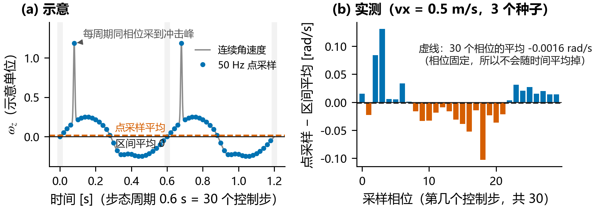

我们在 6 档不同步速（0.2～1.0 m/s）下采集闭环直行轨迹，将 $e$ 按上式拆解（下表）：

| 步速 $v_x$ [m/s] | 等效零偏 $e$ [$10^{-3}$ rad/s] | 采样混叠项 | 欧拉运动学项 | 55 s 纯积分误差：点采样 $\omega_z$ | 55 s 纯积分误差：区间 $\omega_z$ | 55 s 纯积分误差：区间三轴 + 欧拉率公式 |
|---:|---:|---:|---:|---:|---:|---:|
| 0.20 | −0.26 | +0.30 | −0.56 | 0.83° | 1.78° | **0.23°** |
| 0.35 | −0.70 | −0.62 | −0.08 | 2.21° | 0.25° | **0.29°** |
| 0.50 | −1.36 | −1.62 | +0.27 | 4.28° | 0.84° | **0.20°** |
| 0.65 | +1.65 | +1.46 | +0.18 | 5.19° | 0.58° | **0.01°** |
| 0.80 | +0.25 | +0.38 | −0.13 | 1.32° | 0.42° | **0.03°** |
| 1.00 | +3.46 | +3.87 | −0.41 | **10.90°** | 1.30° | **0.14°** |

可以看到，$e$ 在 $-1.36\times 10^{-3}$ 到 $+3.46\times 10^{-3}\text{ rad/s}$ 之间随步速变号，其中 5 档步速下**采样混叠项占绝对主导**。在 $v_x = 1.0\text{ m/s}$ 时，仅靠点采样陀螺积分 55 s 就会累积 **10.90°** 的纯运动学漂移；而改用区间平均三轴角速度代入欧拉率公式后，全步速下的累积误差都压到了 **0.3° 以内**。

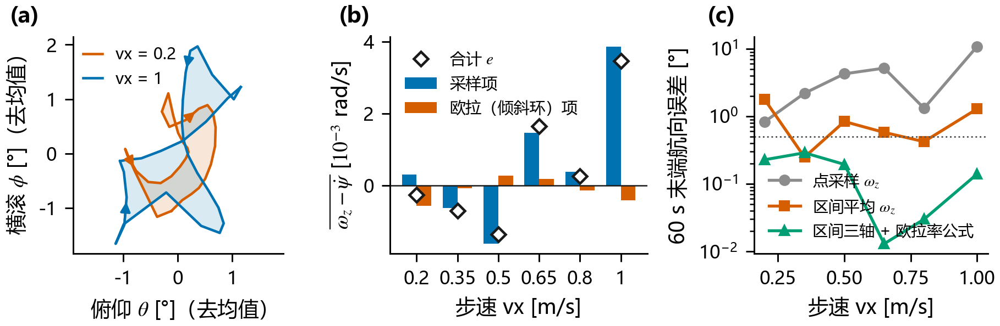

### 2.2 对状态估计与变速工况的影响

在卡尔曼滤波器看来，步态等效零偏 $e$ 与真实的陀螺常值零偏 $b_0$ 完全不可区分，滤波器的零偏状态实际收敛到 $b_0 + e$。这带来两个直接的工程后果：

1. **开机静止标定无法消除步态零偏**：静止时 $e = 0$，即便开机前把真实零偏 $b_0$ 标定得再准，一旦迈步走起来，点采样下仍会多出 $10^{-3}\text{ rad/s}$ 量级的等效零偏需要滤波器重新在线吸收。
2. **变速时产生“假零偏阶跃”**：我们在闭环变速场景（30 s 时步速从 $0.5\text{ m/s}$ 切到 $0.8\text{ m/s}$）中对比了极小过程噪声的 `C*`（$q_b=10^{-16}$）和较大过程噪声的 `C8`（$q_b=10^{-8}$）：

| 陀螺信号处理 | 方案 | 变速前 [10, 30) s 误差 | 变速后 [60, 90) s 误差 |
|---|---|---:|---:|
| **50 Hz 点采样** | `C*` ($q_b=10^{-16}$) | 0.98 ± 0.19° | **1.44 ± 0.39°**（变差） |
| **50 Hz 点采样** | `C8` ($q_b=10^{-8}$) | 1.05 ± 0.15° | **1.00 ± 0.24°**（表面更优） |
| **区间平均（去混叠）** | `C*` ($q_b=10^{-16}$) | 0.98 ± 0.16° | **0.53 ± 0.25°**（持续收敛） |
| **区间平均（去混叠）** | `C8` ($q_b=10^{-8}$) | 1.04 ± 0.13° | **0.98 ± 0.24°**（仅受噪声限制） |

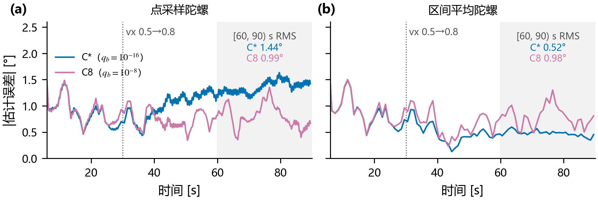

如果只看点采样实验，很容易得出一个错误结论：“机器人变速时陀螺零偏会变，所以要把 $q_b$ 调大（选 `C8`）”。但实际上，这是因为点采样下步速从 0.5 变到 0.8 m/s 时，锁相混叠产生了 $1.6\times 10^{-3}\text{ rad/s}$ 的人工阶跃；一旦改用区间平均角速度去掉混叠，阶跃大幅缩小，`C*` 在变速后误差继续收敛到 **0.53°**，明显优于放大了参考噪声的 `C8`（0.98°）。**正确的做法是在底层用高频角增量/区间平均修正陀螺信号，而不是调大滤波器的 $q_b$。**

---

## 3. 方案 B 与方案 C 的机理对比与参数整定

### 3.1 方案 C 的误差下限：为什么只由参考决定？

当 $q_b \to 0$（如 `C*` 取 $q_b=10^{-16}$）时，卡尔曼滤波器把零偏视为常数，等价于**递推最小二乘（RLS）**。扣掉陀螺积分后，估计当前航向就相当于用过去收到的 $N$ 个带噪参考点（间隔 $T = 1/f_{\mathrm{ref}}$，方差 $\sigma_a^2$）拟合一条过原点的直线 $\psi(t) \approx \beta t$（因为初始航向先验 $0.01\text{ rad}$ 远紧于 $\sigma_a = 0.05\text{ rad}$，截距被锚定在 0 附近）。

由线性回归的末端预测方差公式可得：

$$\operatorname{Var}\hat{\psi}(t_N) \approx \frac{t_N^2\,\sigma_a^2}{\sum_{j=1}^N t_j^2} = \frac{6N\sigma_a^2}{(N+1)(2N+1)} \xrightarrow{N\gg 1} \frac{3\sigma_a^2}{N}, \qquad \operatorname{SD} \approx \frac{\sqrt{3}\,\sigma_a}{\sqrt{N}}$$

这个简单的解析式与精确协方差递推在名义工况下相差不到 3%。它直接说明了方案 C 的三个核心特征：
1. **精度下限由参考决定，与陀螺噪声几乎无关**（BMI088 档下陀螺噪声项仅占 0.039°，参考噪声项占 0.765°）；
2. **误差随运行时间按 $1/\sqrt{t}$ 持续下降**（30～60 s 时约 0.81°，240～300 s 时降至 0.43°）；
3. **误差与 $\sigma_a$ 成正比，与 $\sqrt{f_{\mathrm{ref}}}$ 成反比**。

### 3.2 方案 B 为什么差：早期零偏残差的永久积分两难

方案 B 的反馈量 $i(t)$ 从不被参考直接拉回，它的航向误差是零偏估计误差的时间积分：

$$i(t) - \psi(t) = -\int_0^t \big(\hat{b}(s) - b_0\big)\,ds + (\text{陀螺噪声与运动学项})$$

当开机初始零偏未知时，早期 $\hat{b}$ 收敛前的误差一旦被积分进 $i(t)$，就**永远不会被清除**。这让方案 B 在整定 $q_b$ 时陷入两难：
- **$q_b$ 取小（如 $10^{-16}$）**：零偏收敛慢，早期的零偏残差被长时间积分，稳态航向出现巨大的常值偏置（期望 RMS 达 3.98°）；
- **$q_b$ 取大（如 $10^{-4}$）**：零偏收敛快，早期积分偏置小，但稳态卡尔曼增益 $K_1 \approx -0.61\text{ s}^{-1}$ 很大，每次参考更新都会把参考噪声注入 $\hat{b}$，再经积分变成航向的随机游走。

折中后的族内最优点 `B*`（$q_b = 10^{-4}$）在 [30, 60) s 的期望 RMS 为 **2.39°**，依然是 `C*`（**0.80°**）的 3 倍，且随运行时间延长完全不会下降（在 240～300 s 窗口仍为 2.38°）。

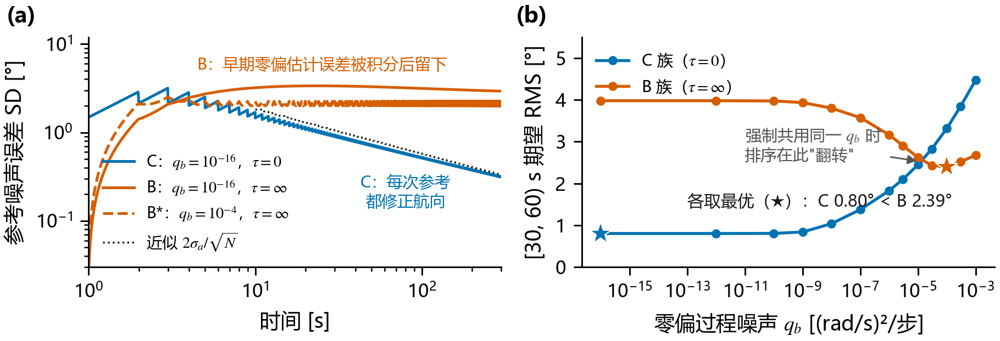

上图 (b) 还揭示了一个在方法对比中很容易踩的坑：**比较不同反馈结构时，必须让各方案取各自的最优参数，绝不能强制共用同一个 $q_b$。** 可以看到 B 族和 C 族的误差曲线在 $q_b \approx 3\times 10^{-5}$ 处交叉——如果人为规定两者共用 $q_b = 10^{-4}$，就会得出“B 比 C 好”的假结论；各取最优整定时，`C*` 比 `B*` 低 **1.59°**。

### 3.3 平滑时间常数 $\tau$ 的作用与选取规则

在 `C*`（$q_b = 10^{-16}$）的基础上引入低通时间常数 $\tau$（即方案族 $S(10^{-16}, \tau)$），扫描整个 $(q_b, \tau)$ 参数平面与不同参考更新率下的表现：

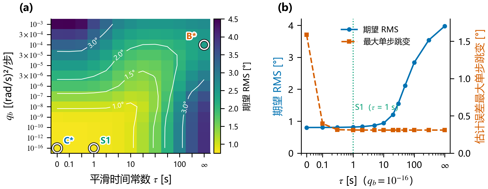
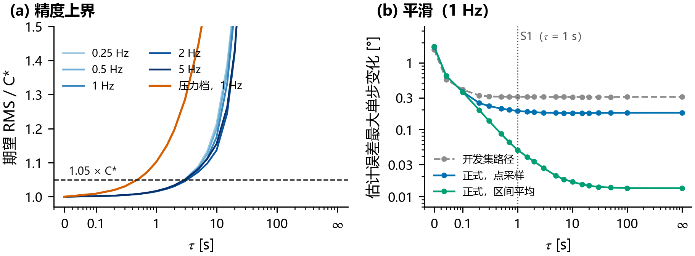

- **精度上界（$\tau$ 最大能取多少？）**：若要求期望 RMS 相比 `C*` 的劣化不超过 5%，在 BMI088 档陀螺下，无论参考更新率是 0.25 Hz 还是 5 Hz，**$\tau$ 的精度上界恒为 2～3 s**；而换成噪声大 87 倍的压力档陀螺后，上界降至 **0.3～0.5 s**。这说明 $\tau$ 的上限由陀螺仪质量（两次修正之间纯积分能撑多久）决定，与参考更新周期无关。
- **平滑收益（$\tau$ 需要取多大？）**：平滑收益来得非常快。当 $\tau$ 取 **0.3～1 s** 时，参考更新带来的阶梯跳变就已经被彻底抚平，剩余的单步反馈变化收敛到机器人步态摆动本身的底噪水平。
- **工程选型（`S1`）**：取 **$\tau = 1\text{ s}$**（记为方案 `S1`），处于 2～3 s 精度安全边界之内，同时在 0.5 Hz、1 Hz、2 Hz 参考率下都能把收敛期的最大反馈跳变从 1.0°～3.6° 一致压低到 **0.40°**（点采样）或 **0.28°**（区间平均）。

### 3.4 名义工况误差预算与闭环验证

在 10 个独立随机种子上运行 60 s 名义工况闭环实验（场景 N），各方案的误差构成与闭环表现如下：

| 陀螺信号 | 方案 | 期望 RMS $J$ | 运动学项 | 零偏残差项 | 陀螺噪声项 | 参考噪声项 | 闭环反馈跳变 [5, 60) s | 闭环指令跳变 [rad/s] |
|---|---|---:|---:|---:|---:|---:|---:|---:|
| 点采样 | `B*` ($q_b=10^{-4}, \tau=\infty$) | **2.387°** | 0.178° | 1.097° | 0.015° | 2.088° | 0.42° | 0.0091 |
| 点采样 | `C*` ($q_b=10^{-16}, \tau=0$) | **0.797°** | 0.218° | 0.003° | 0.039° | 0.765° | 1.77° | 0.0533 |
| 点采样 | `S1` ($q_b=10^{-16}, \tau=1\text{ s}$) | **0.807°** | 0.214° | 0.003° | 0.042° | 0.777° | **0.40°** | **0.0086** |
| 区间平均 | `B*` ($q_b=10^{-4}, \tau=\infty$) | **2.380°** | 0.052° | 1.097° | 0.015° | 2.088° | 0.29° | 0.0056 |
| 区间平均 | `C*` ($q_b=10^{-16}, \tau=0$) | **0.769°** | 0.064° | 0.003° | 0.039° | 0.765° | 1.80° | 0.0527 |
| 区间平均 | `S1` ($q_b=10^{-16}, \tau=1\text{ s}$) | **0.781°** | 0.066° | 0.003° | 0.042° | 0.777° | **0.28°** | **0.0053** |

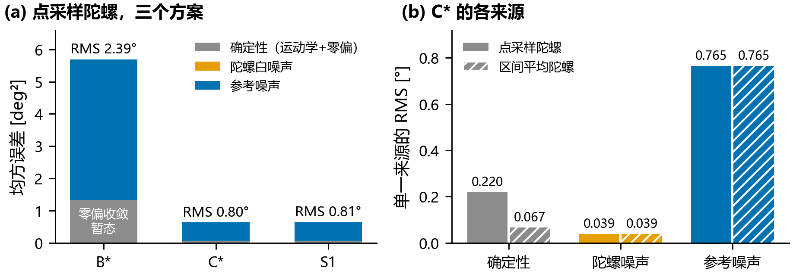
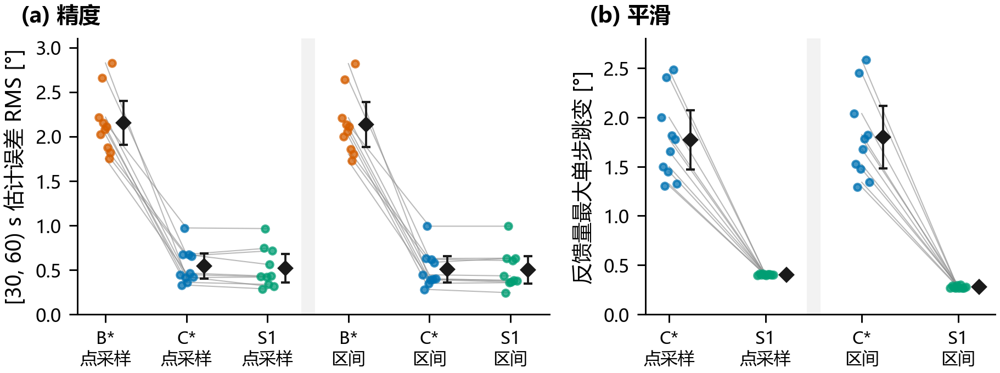

10 个种子上的闭环配对比较无一例外：
- `C*` 比 `B*` 的估计误差 RMS 平均低 **1.61°**（10/10 种子一致，$p < 10^{-5}$）；
- `S1` 与 `C*` 的精度几乎完全重合（闭环差值 < 0.02°），但把最大单步反馈跳变从 **1.77°** 降到了 **0.40°**，转向指令跳变从 **0.053 rad/s** 降到了 **0.009 rad/s**（降低约 6 倍），与纯积分的 `B*` 持平。

---

## 4. 参考信号中断、无扰恢复与策略鲁棒性

在实际部署中，视觉/激光定位或 GNSS 参考可能因为遮挡、走廊退化等原因暂时中断。我们在 90 s 闭环运行中切断 [20, 50) s 期间的绝对参考（中断 30 s，场景 O），检验各方案的退化与恢复行为。

### 4.1 中断期间：为什么 `B*` 会彻底失控？

中断期间没有参考更新，所有方案都只能沿用中断前一刻冻结的零偏估计 $\hat{b}_{\text{freeze}}$ 做纯陀螺积分，航向漂移率就等于那一刻的零偏估计误差 $\hat{b}_{\text{freeze}} - (b_0 + e)$。

- **`B*` 的致命矛盾**：为了在有参考时少积攒早期偏置，`B*` 必须选很大的 $q_b = 10^{-4}$，导致 $\hat{b}$ 时刻跟着参考噪声大幅波动（理论标准差达 $0.036\text{ rad/s}$，即 $2.1^\circ/\text{s}$）。参考切断瞬间，这个巨大的瞬时零偏误差被冻结下来，30 s 内直接积分出数十度的航向跑偏；更糟的是，50 s 参考恢复后，由于 B 不直接修正航向，已经攒下的偏差永远无法消除，[60, 90) s 稳态误差停留在 **49.4 ± 46.9°**（最大种子达 126°）。
- **`C*` 的稳健保持**：`C*` 取 $q_b = 10^{-16}$，中断前已对 19 次参考做了最小二乘平均，冻结时的零偏误差标准差仅 $0.0010\text{ rad/s}$（约 $0.06^\circ/\text{s}$）。中断 30 s 期间误差仅微增至 **1.29°**，恢复参考后迅速回到 **0.61°**。

| 方案（点采样） | 中断前 [10, 20) s | 中断中 [20, 50) s | 恢复初期 [50, 60) s | 恢复稳态 [60, 90) s | 恢复瞬间反馈跳变 | 恢复瞬间指令跳变 [rad/s] |
|---|---:|---:|---:|---:|---:|---:|
| `B*` | 1.93 ± 0.50° | 29.4 ± 28.0° | 49.4 ± 47.3° | **49.4 ± 46.9°** | 0.39 ± 0.03° | 0.008 |
| `C*` | 1.12 ± 0.30° | **1.29 ± 0.75°** | 1.36 ± 0.75° | **0.61 ± 0.19°** | 1.91 ± 1.18° | 0.047 |
| `S1` | 1.25 ± 0.57° | **1.17 ± 0.67°** | 1.30 ± 0.80° | **0.63 ± 0.21°** | **0.39 ± 0.01°** | **0.008** |

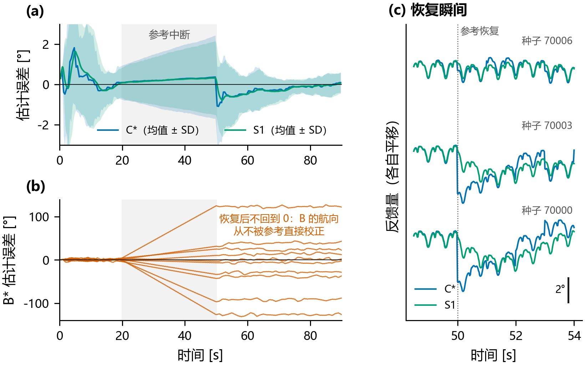

### 4.2 恢复瞬间的跳变与 `S1` 无扰切换

`C*` 的唯一问题是恢复瞬间的一次跳变（平均 1.91°）。这是因为中断 30 s 期间，滤波器内部的航向协方差因积分不确定性不断膨胀，导致 50 s 恢复后第一拍的卡尔曼增益 $K_0$ 飙升至 **0.56**（中断前仅为 0.15），一步吞入了累积漂移和当拍 56% 的参考噪声。

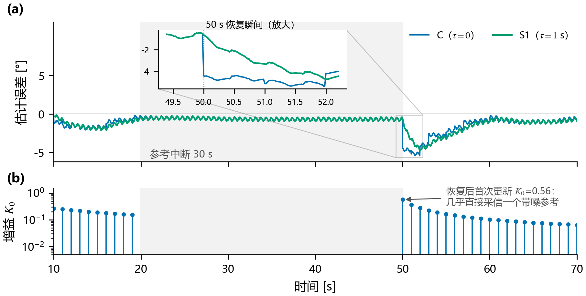

`S1`（$\tau = 1\text{ s}$）在这里天然充当了控制工程中的**无扰切换（Bumpless Transfer）**器：它把这步阶跃修正分摊在约 1 s 内指数释放，使恢复瞬间的单步反馈跳变从 **1.91°** 降至 **0.39°**（指令跳变从 0.047 rad/s 降至 0.008 rad/s），且没有引入任何可测的恢复延迟。

### 4.3 冻结的 RL 策略到底能扛住多大的指令跳变？

一个很自然的疑问是：`C*` 在收敛初期或中断恢复时产生的指令跳变（均值约 0.05 rad/s，极值约 0.125 rad/s）会不会把机器人晃倒或破坏步态？

为此我们专门设计了**指令阶跃承受度实验**：在正常闭环行走的第 20 s，直接向转向指令 $v_{\mathrm{yaw}}$ 注入持续 **1 s（50 个控制步）** 的矩形脉冲（比真实单步跳变严苛得多），幅值从 $A = 0.05\text{ rad/s}$ 递增到 $2.0\text{ rad/s}$（超出训练分布上限 $1.0\text{ rad/s}$ 一倍），测试 5 个不同步态相位起点：

| 脉冲幅值 $A$ [rad/s] | 对应物理意义 | 摔倒次数 | 机身最大倾角超额增量 [°] | 航向最大偏离 [°] |
|---:|---|---:|---:|---:|
| 0（基线对照） | 正常闭环行走（正常倾角峰值约 1.55°） | 0 / 5 | — | 2.05 |
| **0.05** | `C*` 收敛期/恢复期**平均指令跳变**量级 | 0 / 5 | **+0.007 ± 0.035°** | 2.28 |
| **0.125** | `C*` 观测到的**最大单步指令跳变**量级 | 0 / 5 | **+0.077 ± 0.063°** | 3.77 |
| 0.25 | 2 倍最大跳变 | 0 / 5 | +0.189 ± 0.068° | 7.12 |
| 0.50 | 中等扰动对照 | 0 / 5 | +0.448 ± 0.080° | 13.65 |
| 1.00 | RL 训练期指令上限 | 0 / 5 | +0.969 ± 0.138° | 26.62 |
| 2.00 | 超出训练上限 2 倍 | 0 / 5 | +2.093 ± 0.442° | 51.34 |

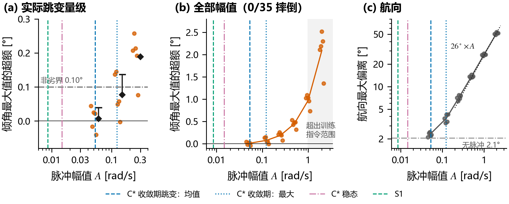

实验结果非常明确：
- 即使注入持续 1 s 的 $2.0\text{ rad/s}$ 极端脉冲，策略也全部稳住没有摔倒；
- 在 `C*` 实际可能产生的跳变量级（$0.05\sim 0.125\text{ rad/s}$）下，哪怕维持整整 1 s，机身最大倾角的增加也只有 **0.007°～0.077°**（不到正常行走倾角峰值的 5%）。
- 这说明对于经过域随机化和推扰训练的底层 RL 策略而言，**`S1` 平滑的真正工程价值在于消除控制指令毛刺、保护执行器并改善航向过渡瞬态，而不是为了防止机器人摔倒。**

---

## 5. 工况边界：参考质量与开机静止标定

### 5.1 不同参考精度与更新率

在参考更新率 $f_{\mathrm{ref}} \in [0.25, 5]\text{ Hz}$、参考噪声 $\sigma_a \in [0.02, 0.1]\text{ rad}$ 的 15 组网格以及 0.5 Hz / 2 Hz 闭环实验中：
- `C*` 在所有组合下全面优于 `B*`（误差仅为 `B*` 的 22%～53%），参考越准、更新越快，`C*` 的优势越明显；
- 低参考率（如 0.5 Hz）下，`C*` 收敛初期的单步反馈跳变会放大到 **3.64°**，而 `S1`（$\tau=1\text{ s}$）依然能将其稳定压在 **0.41°**，同时精度与 `C*` 相差不超过 0.04°。

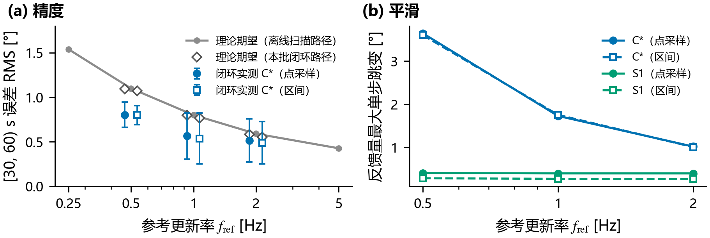

### 5.2 如果开机前做了高精度静止标定，B 能追上 C 吗？

前面的实验默认开机零偏未知（先验标准差 $0.05\text{ rad/s}$）。如果工程上在机器人启动前做了充分的静止采集标定，把常值零偏 $b_0$ 扣掉，结果会怎样？我们在闭环轨迹上做了反事实重放（注意：静止标定只能消除器件常值零偏 $b_0$，**无法消除第 2 节指出的行走步态混叠项 $e$**）：

| 零偏先验设定 | 60 s 名义误差（点采样）：B 族 / C 族 | 60 s 名义误差（区间平均）：B 族 / C 族 | 300 s 长时程误差：B 族 / C 族 | 30 s 中断恢复后误差：B 族 / C 族 |
|---|---|---|---|---|
| 开机零偏未知（0.05 rad/s） | 2.39° / **0.80°** | 2.38° / **0.77°** | 2.38° / **0.43°** | 62.2° / **0.74°** |
| 标定残差 $10^{-3}\text{ rad/s}$ | 1.12° / **0.77°** | 0.91° / **0.73°** | 1.13° / **0.44°** | 11.5° / **0.72°** |
| 理想标定（残差 0） | **0.99°** / 1.03° | 0.59° / **0.52°** | 1.00° / **0.59°** | 2.04° / **1.05°** |

可以看到：
1. 即便做到了“残差为 0”的理想静止标定，一旦跑长时程（300 s）或遇到参考中断，**C 族依然显著优于 B 族**（接近一倍差距），因为 B 族的航向误差不随时间收敛。
2. 更有意思的是：在点采样下，如果因为做了“理想静止标定”就把滤波器的初始零偏先验方差收得太紧，滤波器反而无法在线吸收迈步后出现的步态混叠项 $e$，导致 C 族误差从 0.77° 恶化到 1.03°；只有配合区间平均去掉步态混叠后，理想标定才能真正发挥作用（降至 0.52°）。

---

## 6. 工程落地建议总结

如果你正在为固定 RL 步态策略的人形或四足机器人搭建上层航向保持回路，可以直接采用以下 4 条设计准则：

1. **反馈结构选 `S1`（直接融合 + 1 s 修正量低通），淘汰纯补偿积分 B**
   - 用两状态卡尔曼滤波融合陀螺与绝对参考，反馈量按 $S_k = i_k + \mathrm{LPF}_\tau(f_k - i_k)$ 构造。
   - 对常见 MEMS 陀螺（如 BMI088 级），取 **$\tau \approx 1\text{ s}$**，既能拿到直接融合 `C*` 的全部精度和抗中断能力，又能把收敛期与重定位恢复时的阶跃跳变完全抹平，且不滞后机体自身的快速转动。
2. **陀螺积分务必使用高频角增量（区间平均）+ 欧拉率换算，避开控制频率点采样**
   - 不要直接拿 50 Hz 策略步的瞬时角速度 $\omega_z$ 去积分。步态周期与控制周期的整数倍锁相会产生 $10^{-3}\text{ rad/s}$ 量级、随步速变号的混叠漂移。在 IMU 驱动层输出帧间角增量并按横滚/俯仰换算 $\dot{\psi}$，可将 55 s 步态积分漂移从 10.9° 压到 0.3° 以内。
3. **零偏过程噪声 $q_b$ 按真实温漂匹配，不要为了适应变速而调大 $q_b$**
   - 在百秒级中短时程内将 $q_b$ 设为极小值（接近常值零偏假设），让滤波器充分平均历史参考噪声；若长时程运行存在温漂，再将 $q_b$ 匹配至器件手册的零偏随机游走（Bias Instability）。切勿用调大 $q_b$ 的方式去掩盖步态混叠造成的变速跳变。
4. **上层控制器加入微弱积分项（PID）消除步态不对称偏置**
   - 冻结的 RL 策略在直行时往往需要微小的非零平均转向指令（如本文 G1 约需 $0.017\text{ rad/s}$）。在 `S1` 给出无偏航向反馈的基础上，上层控制器在 PD 之外加入小增益积分项或前馈偏置，即可消除约 $1^\circ$ 的物理航向稳态静差。

---

## 附：代码与复现指南

本仓库包含完整的闭环实验协议、离线误差分解器与图表生成脚本。完整的闭环原始轨迹数据包已发布在 [**GitHub Releases (`v1.0`)**](https://github.com/ThorHe-Hub/unitree_rl_mjlab/releases/tag/v1.0) 中，解压至项目根目录后无需重新跑 GPU 仿真即可一键复现文中全部表格与图片：

```bash
# 0. 下载并解压闭环实验原始轨迹数据包（约 225 MB）
curl -L https://github.com/ThorHe-Hub/unitree_rl_mjlab/releases/download/v1.0/heading_experiment_data.tar.gz | tar -xz

# 1. 从已记录的 208 条设计族闭环轨迹与 35 条脉冲轨迹生成统计结果
python analyze_design_family_formal.py
python analyze_pulse_formal.py

# 2. 运行离线参数网格扫描与补充分析（协方差递推、蒙特卡洛、零偏先验反事实重放）
python analyze_design_family.py
python analyze_design_family_sweeps.py
python analyze_thesis_supplement.py

# 3. 重新生成全部图表（输出至 figs/v3/）
python make_figures_v3.py

# 4. 运行单元测试（验证误差线性分解恒等式与滤波器实现）
python -m unittest discover -s tests
```
